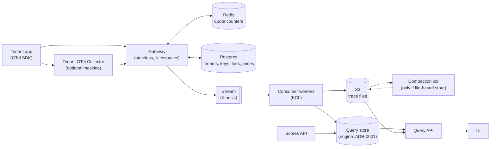

# 02 — High-Level Design

| | |
|---|---|
| **Status** | Draft (part 1 of 2) |
| **Owner** | Hossam Hosny |
| **Last updated** | 2026-11-22 |
| **Related docs** | [01-requirements.md](01-requirements.md), [03-failure-modes.md](03-failure-modes.md), [adr/](adr/) |

## 1. Summary

Tenants export OTLP traces to a stateless **gateway**, which authenticates them, enforces size limits, rate limits and daily quotas, samples over-quota traffic, counts tokens and cost, and acknowledges only after a durable write to a **stream**. **Consumer workers** read the stream, group spans by tenant, buffer them for up to 60 s or 2 MB, deduplicate them and write them to **object storage** and the **query store**. A **query API** serves the UI. Postgres holds tenant configuration; Redis holds shared quota counters.

**Two possible shapes, decided in ADR-0001:**
- **File-based:** Parquet files on S3, with a table format (e.g. Iceberg) and a query engine (Athena/Trino). Needs our own compaction job.
- **Database-based:** an OLAP database (e.g. ClickHouse) as the query store, with S3 for raw events and large payloads. The database merges small inserts itself, so there's no separate compaction job.

## 2. Components

| Component | Responsibility | Scaling unit | State |
|---|---|---|---|
| **Gateway** | Authenticate API key → tenant (FR-TEN-001); reject requests > 4 MB, truncate spans > 1 MB; enforce per-tenant **rate limit** (token bucket, 429; may move to the load balancer layer); track per-tenant **daily quota** and switch to trace-ID sampling above it; count tokens and cost for every received span (FR-PRC-002); write accepted spans to the stream and ack only after success (FR-ING-006) | Instance (stateless, behind a load balancer) | Local token buckets and quota-counter cache only |
| **Quota counter store (Redis)** | Shared per-tenant daily byte counters; gateways sync local counts at least every 10 s (NFR-ISO-004) | Single primary + replica | Counters reset daily |
| **Tenant config store (Postgres)** | Tenants, API keys, tiers and limits, model price table | Single primary + replica | Source of truth; cached in gateways |
| **Stream (Kinesis)** | Durable, replayable buffer between ingest and processing; decouples gateway latency from storage latency | Shard (1 MB/s or 1,000 records/s write) | Records kept for the stream retention period |
| **Consumer workers** | Read shards (KCL leases); group spans by tenant; buffer ≤ 60 s or 2 MB per tenant buffer; dedup by (trace_id, span_id); write files/rows; checkpoint only after flush | Worker (owns a set of shards) | In-memory buffers; checkpoints in KCL's lease table |
| **Object storage (S3)** | Trace data files partitioned by tenant; large payloads (see ADR-0002); short-lived raw copy for replay | Prefix | 14-day lifecycle on trace data; 3 days on raw |
| **Compaction job** *(file-based shape only)* | Merge small files into large ones, dedup during merge, swap atomically (table-format commit) | Job per partition | None beyond the table metadata |
| **Query store** | Serve trace lookup, search by session/user/model/error/score, and cost aggregates | Depends on ADR-0001 | 14-day TTL on traces; longer on aggregates (Q2) |
| **Query API** | Tenant-scoped queries (tenant from credential, never from the request); fetch payloads on demand | Instance (stateless) | None |
| **Scores API** | Attach eval scores and feedback to a trace or span (FR-ING-007), idempotently | Instance (stateless) | Writes to the query store |
| **UI** | Trace explorer, usage and quota, cost by model | Static app | None |

## 3. Infrastructure sizing

Inputs from [01-requirements §9](01-requirements.md#9-capacity-estimates): average 84 MB/s, peak 336 MB/s, ≈ 2,200 spans/s at peak, 5,000 tenants.

Assumptions for this section (validate in the thin slice):
- **HL-A1:** one consumer worker can process ~40 MB/s (decode, group, Parquet-encode, upload). Run at ≤ 50% so the others can absorb a failed worker's shards → **20 MB/s per worker**.
- **HL-A2:** one gateway instance handles ~100 MB/s of TLS + OTLP decode. Run at ≤ 50% → **50 MB/s per instance**.

| Quantity | Formula | Value |
|---|---|---|
| Kinesis shards (spans in the stream) | peak MB/s ÷ 1 MB/s per shard × 1.3 headroom | 336 × 1.3 ≈ **440 shards** |
| Kinesis shards (S3-first: only references in the stream, ADR-0002) | peak records/s ÷ 1,000 per shard × headroom | ≈ **3–5 shards** |
| Consumer workers at peak | peak MB/s ÷ 20 MB/s | 336 ÷ 20 ≈ **17 workers** (≈ 26 shards each) |
| Consumer workers at average | average MB/s ÷ 20 MB/s | 84 ÷ 20 ≈ **5 workers** (autoscale between) |
| Buffer memory per worker | per-worker rate × buffer age | 20 MB/s × 60 s ≈ **1.2 GB**, plus encoding overhead ≈ 2.5 GB heap |
| Gateway instances at peak | peak MB/s ÷ 50 MB/s | 336 ÷ 50 ≈ **7 instances** (excludes rejected over-limit traffic, Q5) |
| Redis operations | gateways × active tenants ÷ sync interval | 7 × 5,000 ÷ 10 s ≈ **3,500 ops/s** |
| S3 files/day, random or trace_id stream key | workers × tenants × 1,440 flushes | 17 × 5,000 × 1,440 ≈ **122M/day** |
| S3 files/day, salted key with k = 1 for Normal tenants | Normal tenants × 1 × 1,440 (+ Pro, ADR-0003) | 4,750 × 1,440 ≈ **6.8M/day** + Pro |

What these numbers say:
- **Shard count depends on ADR-0002.** Sending full spans through Kinesis needs ~440 shards. Sending only references after an S3-first write needs a handful.
- **Redis is not a throughput problem.** 3,500 ops/s is small. Local counters are about availability: if Redis is down, ingest continues on local counts (fail open, bounded by the rate limit).
- **The stream key decides the file count.** With a random or trace_id key, every worker holds a buffer for almost every tenant, so files grow with worker count (~122M/day). A salted tenant key keeps each tenant on k shards. This goes to ADR-0003.
- **Worker memory is bounded** by rate × buffer age, not by tenant count.

## 4. Freshness budget

Target: p99 ≤ 120 s from ack to queryable (NFR-PERF-005).

| Stage | Budget | Notes |
|---|---|---|
| Gateway → stream write | in the ack path | Not counted: freshness starts at the ack |
| Stream put → worker read | ≤ 2 s | KCL polling; less with enhanced fan-out |
| Worker buffer | ≤ 60 s | Max buffer age; flush earlier at 2 MB |
| Write to S3 / insert into query store | ≤ 5 s | |
| Query store visibility | ≤ 30 s | Table-format commit interval, or immediate for an OLAP insert (ADR-0001) |
| Headroom | ≈ 23 s | Retries, GC pauses, short lag spikes |
| **Total** | **120 s** | |

**Most likely to break first: consumer lag.** If workers fall behind, records wait in the stream before the 60 s buffer even starts, and that wait has no ceiling. The early warning is the stream's iterator age (Kinesis `GetRecords.IteratorAgeMilliseconds`); alert well before it reaches the headroom.

## 5. Data flows

*Part 2 (ST-22): write path, read path, late-score path, as sequence diagrams.*

## 6. Data model

*Part 2: span and trace records, metadata vs payload, trace-level index for session.id and user.id.*

## 7. API contract

*Part 2: ingest responses (success, partial success, 401, 413, 429 + Retry-After), query API, scores API.*

## 8. Tenancy across layers

*Part 2: how isolation holds at the gateway, stream, workers, storage and query.*

## 9. Traceability

*Part 2: NFR ID → design element that satisfies it.*

## 10. Open design questions

| # | Question | Goes to |
|---|---|---|
| HQ1 | File-based (Parquet + table format) or database-based (OLAP) query store? Decides whether a compaction job exists. | ADR-0001 |
| HQ2 | Full spans through the stream, or S3-first with references? Decides shard count and what the ack's durable write is. | ADR-0002 |
| HQ3 | Stream key and k per tier. Decides files/day and hot-tenant spread. | ADR-0003 |
| HQ4 | Kinesis or Kafka (self-managed or MSK)? | ADR-0005 (new) |
| HQ5 | ~~How long to keep the raw S3 copy for replay?~~ **Decided: 3 days.** Longer than the stream's retention, so a bad deploy can be replayed after the stream has expired. | Decided |
| HQ6 | Where scores live: with traces in the query store (filterable) or in Postgres? | ADR-0001 |
| HQ7 | Rate limiting across gateway instances: per-instance share (limit ÷ N) or a shared limiter? | ADR-0003 |

## 11. Change history

| Date | Author | Change |
|---|---|---|
| 2026-11-22 | Hossam Hosny | Part 1: summary, components, infrastructure sizing, freshness budget, open questions |
| 2026-11-22 | Hossam Hosny | Rate limit at gateway or load balancer; daily quota in Redis; raw copy kept 3 days |