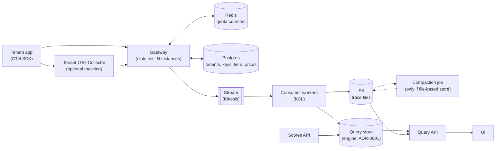
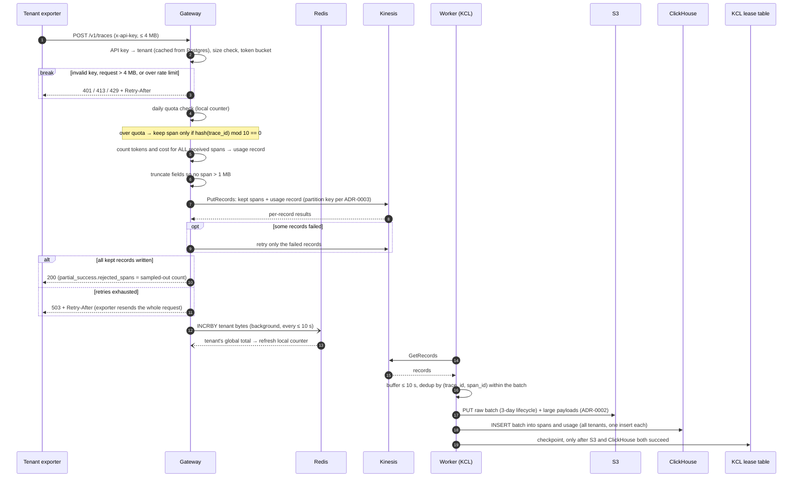
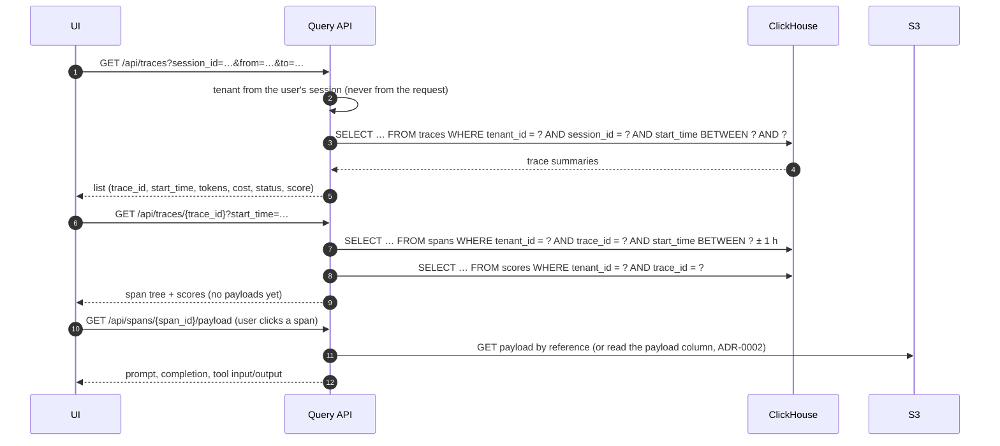
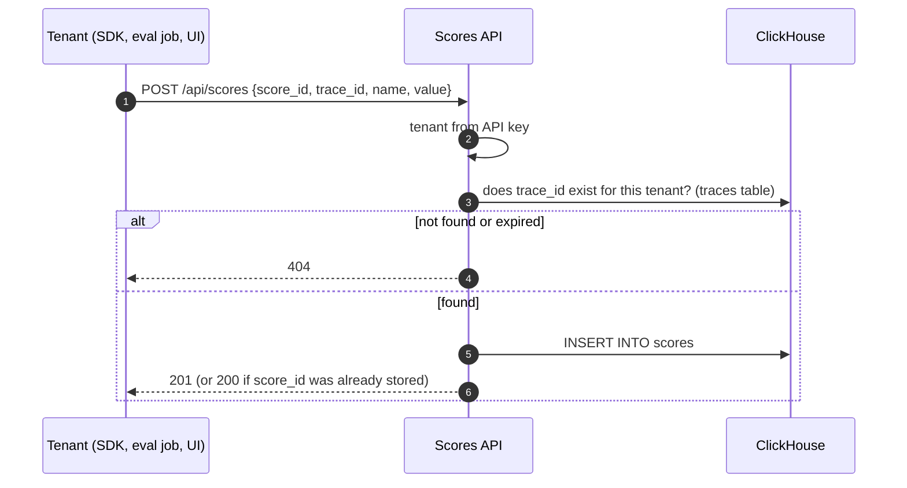

# 02 — High-Level Design

| | |
|---|---|
| **Status** | Draft (parts 1 and 2; §5–9 assume ClickHouse pending ADR-0001) |
| **Owner** | Hossam Hosny |
| **Last updated** | 2026-11-24 |
| **Related docs** | [01-requirements.md](01-requirements.md), [03-failure-modes.md](03-failure-modes.md), [adr/](adr/) |

## 1. Summary

Tenants export OTLP traces to a stateless **gateway**, which authenticates them, enforces size limits, rate limits and daily quotas, samples over-quota traffic, counts tokens and cost, and acknowledges only after a durable write to a **stream**. **Consumer workers** read the stream, buffer them (≤ 10 s per worker batch with ClickHouse; ≤ 60 s or 2 MB per tenant in the file-based shape), deduplicate them and write them to **object storage** and the **query store**. A **query API** serves the UI. Postgres holds tenant configuration; Redis holds shared quota counters.

**Two possible shapes, decided in ADR-0001:**
- **File-based:** Parquet files on S3, with a table format (e.g. Iceberg) and a query engine (Athena/Trino). Needs our own compaction job.
- **Database-based:** an OLAP database (e.g. ClickHouse) as the query store, with S3 for raw events and large payloads. The database merges small inserts itself, so there's no separate compaction job.

## 2. Components

| Component | Responsibility | Scaling unit | State |
|---|---|---|---|
| **Gateway** | Authenticate API key → tenant (FR-TEN-001); reject requests > 4 MB, truncate spans > 1 MB; enforce per-tenant **rate limit** (token bucket, 429; may move to the load balancer layer); track per-tenant **daily quota** and switch to trace-ID sampling above it; count tokens and cost for every received span (FR-PRC-002); write accepted spans to the stream and ack only after success (FR-ING-006) | Instance (stateless, behind a load balancer) | Local token buckets and quota-counter cache only |
| **Quota counter store (Redis)** | Shared per-tenant daily byte counters; gateways sync local counts at least every 10 s (NFR-ISO-004) | Single primary + replica | Counters reset daily |
| **Tenant config store (Postgres)** | Tenants, API keys, tiers and limits, model price table | Single primary + replica | Source of truth; cached in gateways |
| **Stream (Kinesis)** | Durable, replayable buffer between ingest and processing; decouples gateway latency from storage latency | Shard (1 MB/s or 1,000 records/s write) | Records kept for the stream retention period |
| **Consumer workers** | Read shards (KCL leases); buffer ≤ 10 s as one batch across tenants (ClickHouse) or ≤ 60 s / 2 MB per tenant (file-based); dedup by (trace_id, span_id); write files/rows; checkpoint only after flush | Worker (owns a set of shards) | In-memory buffers; checkpoints in KCL's lease table |
| **Object storage (S3)** | Trace data files partitioned by tenant; large payloads (see ADR-0002); short-lived raw copy for replay | Prefix | 14-day lifecycle on trace data; 3 days on raw |
| **Compaction job** *(file-based shape only)* | Merge small files into large ones, dedup during merge, swap atomically (table-format commit) | Job per partition | None beyond the table metadata |
| **Query store** | Serve trace lookup, search by session/user/model/error/score, and cost aggregates | Depends on ADR-0001 | 14-day TTL on traces; longer on aggregates (Q2) |
| **Query API** | Tenant-scoped queries (tenant from credential, never from the request); fetch payloads on demand | Instance (stateless) | None |
| **Scores API** | Attach eval scores and feedback to a trace or span (FR-ING-007), idempotently | Instance (stateless) | Writes to the query store |
| **UI** | Trace explorer, usage and quota, cost by model | Static app | None |

## 3. Infrastructure sizing

Inputs from [01-requirements §9](01-requirements.md#9-capacity-estimates): average 84 MB/s, peak 336 MB/s, ≈ 2,200 spans/s at peak, 5,000 tenants.

Assumptions for this section (validate in the thin slice):
- **HL-A1:** one consumer worker can process ~40 MB/s (decode, group, Parquet-encode, upload). Run at ≤ 50% so the others can absorb a failed worker's shards → **20 MB/s per worker**.
- **HL-A2:** one gateway instance handles ~100 MB/s of TLS + OTLP decode. Run at ≤ 50% → **50 MB/s per instance**.

| Quantity | Formula | Value |
|---|---|---|
| Kinesis shards (spans in the stream) | peak MB/s ÷ 1 MB/s per shard × 1.3 headroom | 336 × 1.3 ≈ **440 shards** |
| Kinesis shards (S3-first: only references in the stream, ADR-0002) | peak records/s ÷ 1,000 per shard × headroom | ≈ **3–5 shards** |
| Consumer workers at peak | peak MB/s ÷ 20 MB/s | 336 ÷ 20 ≈ **17 workers** (≈ 26 shards each) |
| Consumer workers at average | average MB/s ÷ 20 MB/s | 84 ÷ 20 ≈ **5 workers** (autoscale between) |
| Buffer memory per worker | per-worker rate × buffer age | 20 MB/s × 60 s ≈ **1.2 GB**, plus encoding overhead ≈ 2.5 GB heap |
| Gateway instances at peak | peak MB/s ÷ 50 MB/s | 336 ÷ 50 ≈ **7 instances** (excludes rejected over-limit traffic, Q5) |
| Redis operations | gateways × active tenants ÷ sync interval | 7 × 5,000 ÷ 10 s ≈ **3,500 ops/s** |
| S3 files/day, random or trace_id stream key | workers × tenants × 1,440 flushes | 17 × 5,000 × 1,440 ≈ **122M/day** |
| S3 files/day, salted key with k = 1 for Normal tenants | Normal tenants × 1 × 1,440 (+ Pro, ADR-0003) | 4,750 × 1,440 ≈ **6.8M/day** + Pro |

What these numbers say:
- **Shard count depends on ADR-0002.** Sending full spans through Kinesis needs ~440 shards. Sending only references after an S3-first write needs a handful.
- **Redis is not a throughput problem.** 3,500 ops/s is small. Local counters are about availability: if Redis is down, ingest continues on local counts (fail open, bounded by the rate limit).
- **The stream key decides the file count.** With a random or trace_id key, every worker holds a buffer for almost every tenant, so files grow with worker count (~122M/day). A salted tenant key keeps each tenant on k shards. This goes to ADR-0003.
- **Worker memory is bounded** by rate × buffer age, not by tenant count.

## 4. Freshness budget

Target: p99 ≤ 120 s from ack to queryable (NFR-PERF-005).

| Stage | Budget | Notes |
|---|---|---|
| Gateway → stream write | in the ack path | Not counted: freshness starts at the ack |
| Stream put → worker read | ≤ 2 s | KCL polling; less with enhanced fan-out |
| Worker buffer | ≤ 60 s | Max buffer age; flush earlier at 2 MB. With ClickHouse this drops to ≤ 10 s (§5) |
| Write to S3 / insert into query store | ≤ 5 s | |
| Query store visibility | ≤ 30 s | Table-format commit interval, or immediate for an OLAP insert (ADR-0001) |
| Headroom | ≈ 23 s | Retries, GC pauses, short lag spikes |
| **Total** | **120 s** | |

**Most likely to break first: consumer lag.** If workers fall behind, records wait in the stream before the 60 s buffer even starts, and that wait has no ceiling. The early warning is the stream's iterator age (Kinesis `GetRecords.IteratorAgeMilliseconds`); alert well before it reaches the headroom.

## 5. Data flows

> Sections 5–9 assume **ClickHouse** as the query store (the likely outcome of ADR-0001). If ADR-0001 picks the file-based shape, sections 5.1 and 6 change; the API contract (7) does not.

With ClickHouse, workers no longer keep one buffer per tenant. Each worker keeps **one buffer containing all tenants' spans** and flushes it as a single insert every ~5–10 s (or at a size cap). That is ~17 workers × one insert per 5 s ≈ 3–4 inserts/s for the whole cluster, which is the batch-insert pattern ClickHouse expects, and it removes the per-tenant small-files problem from §3. Tenant separation moves into the table's sort key (§6). Freshness improves too: the buffer stage drops from ≤ 60 s to ≤ 10 s.

### 5.1 Write path

Key points:
- **The ack waits for Kinesis.** Success is returned only after every kept record is in the stream (FR-ING-006). If retries of failed records run out, the gateway returns 503 + Retry-After for the whole request and the exporter retries it. Duplicates from that retry are absorbed by dedup (§6, ADR-0004).
- **Cost counting happens before sampling.** The gateway sends a small usage record (tenant, model, tokens, cost, spans received, spans kept) for every request, so cost reports include sampled-out traffic (FR-PRC-002, NFR-CST-001).
- **Checkpointing after the write** means a worker crash replays at most one buffer (≤ 10 s) of records. That is at-least-once delivery; dedup handles the replays.

### 5.2 Read path

- **Payloads are loaded lazily.** Opening a trace returns metadata only; a span's prompt and completion load when the user clicks it. Search and cost queries never read payloads.
- **Trace lookup passes a time hint.** The `spans` sort key starts with `(tenant_id, start_time, …)`, so a lookup by trace_id alone would scan the tenant's whole 14 days. The UI already knows the trace's start time from the list, so the API passes it. A bloom-filter skip index on trace_id covers direct links that arrive without one.

### 5.3 Late-score path

Scores live in their own table and are joined to traces when read, so attaching one never rewrites span data (FR-ING-007). The client-supplied `score_id` makes retries idempotent.

## 6. Data model

All tables lead their sort key with `tenant_id`, so every tenant's rows are stored together and every query filters on it first.

| Table | Engine | Sort key (`ORDER BY`) | Partition / TTL | Purpose |
|---|---|---|---|---|
| `spans` | ReplacingMergeTree | `(tenant_id, start_time, trace_id, span_id)` | `PARTITION BY toDate(received_at)`, TTL `received_at + 14 days` | One row per span; duplicates collapse during merges |
| `traces` | AggregatingMergeTree, fed by a materialized view on `spans` | `(tenant_id, trace_id)` | TTL `max_received_at + 14 days` | One summary row per trace, built incrementally as spans arrive in any order |
| `scores` | ReplacingMergeTree | `(tenant_id, trace_id, score_id)` | TTL `created_at + 14 days` | Eval scores and feedback |
| `usage` | SummingMergeTree | `(tenant_id, day, model)` | TTL per Q2 (e.g. 13 months) | Tokens, cost, spans received and kept, including sampled-out traffic |

Postgres holds `tenants`, `api_keys` (stored hashed), `tiers` and `model_prices`.

**`spans` columns:** tenant_id, trace_id, span_id, parent_span_id, name, kind (agent / llm / tool / retrieval / other), start_time, end_time, duration_ms, received_at, provider, model, input_tokens, output_tokens, cost_usd, status, error_type, session_id, user_id, sample_rate, truncated, payload_ref (or compressed input/output columns, ADR-0002), attributes (map).

**`traces` columns:** tenant_id, trace_id, start_time (min), end_time (max), root_name, session_id, user_id (taken from the root span when it arrives), span_count, input_tokens, output_tokens, cost_usd (sums), has_error (max), sample_rate, max_received_at.

Design choices worth defending:
- **TTL and partitions use `received_at`, not `start_time`.** `start_time` comes from the client's clock. A skewed clock would make a span expire early or live forever (DDIA Ch. 8, "Unreliable Clocks"). The server's receive time is the one clock we control.
- **`traces` is keyed by `(tenant_id, trace_id)` without time.** Its key must be the same for every span of a trace, and the trace's start time isn't known until the root span arrives. Listing a tenant's traces by time scans that tenant's rows, which is cheap: even a Pro tenant at its full 50 GB/day quota has about 50 GB ÷ 3.23 MB ≈ 15.5k traces/day, so ≈ 217k rows over 14 days.
- **Dedup gap.** ReplacingMergeTree removes duplicates only when parts merge, at an unknown time, so queries can briefly see duplicates. Worse, the `traces` materialized view sums every inserted row, so a replayed span inflates that trace's tokens and cost. Mitigations: dedup in the worker before insert (covers replays within a batch), and an idempotent design for the summary. Decided in ADR-0004.

## 7. API contract

### 7.1 Ingest (OTLP)

`POST /v1/traces` (OTLP/HTTP, protobuf) and `opentelemetry.proto.collector.trace.v1.TraceService/Export` (OTLP/gRPC). Auth header: `x-api-key`.

| Situation | HTTP | gRPC | Client behaviour |
|---|---|---|---|
| All spans accepted | 200 | OK | Done |
| Some spans sampled out (over quota) | 200 + `partial_success` (`rejected_spans`, `error_message`) | OK + `partial_success` | Doesn't retry; logs a warning |
| Malformed request | 400 | INVALID_ARGUMENT | Doesn't retry |
| Missing or invalid API key | 401 | UNAUTHENTICATED | Doesn't retry |
| Request > 4 MB | 413 | RESOURCE_EXHAUSTED, no RetryInfo | Doesn't retry; send smaller batches |
| Over rate limit | 429 + `Retry-After` | RESOURCE_EXHAUSTED + RetryInfo | Retries after the delay |
| Stream unavailable or gateway overloaded | 503 + `Retry-After` | UNAVAILABLE + RetryInfo | Retries with backoff |

### 7.2 Query API (UI)

| Endpoint | Returns |
|---|---|
| `GET /api/traces?from&to&session_id&user_id&model&status&min_score` | Trace summaries, newest first, paginated |
| `GET /api/traces/{trace_id}?start_time` | Span tree with metadata and scores, no payloads |
| `GET /api/spans/{span_id}/payload` | Prompt, completion, tool input/output |
| `GET /api/usage?from&to&group_by=model\|day` | Tokens, cost, spans received and kept |
| `GET /api/quota` | Today's bytes used, quota, current sampling state |

### 7.3 Scores API

`POST /api/scores` with `{score_id, trace_id, span_id?, name, value, source}`. Returns 201 when created, 200 when that `score_id` already exists (idempotent), 404 when the trace is unknown or expired.

## 8. Tenancy across layers

| Layer | How tenants are separated | What stops a hot tenant |
|---|---|---|
| Gateway | Tenant comes only from the API key | Rate limit (429) and over-quota sampling, before anything reaches shared resources |
| Kinesis | Shared stream | Gateway limits cap each tenant's share; partition key spreads hot tenants (ADR-0003) |
| Workers | Shared; one batch holds many tenants | Bounded by the gateway limits upstream |
| ClickHouse | `tenant_id` leads every sort key; the query API adds `tenant_id = ?` to every query; row policies as a second line of defence | Per-tenant query limits in the query API (e.g. max time range, timeouts) |
| S3 | Tenant prefix for payloads and raw batches | — |

## 9. Traceability

| Requirement | Met by |
|---|---|
| FR-ING-001 (OTLP over gRPC and HTTP) | §7.1 |
| FR-ING-003, FR-ING-004 (rate limit, over-quota sampling) | Gateway, §5.1 |
| FR-ING-005 (partial success) | §7.1 |
| FR-ING-006 (ack after durable write) | §5.1 |
| FR-ING-007 (late scores) | §5.3, `scores` table |
| FR-PRC-002, NFR-CST-001 (cost includes sampled-out traffic) | Usage record from the gateway, `usage` table |
| FR-PRC-003 (out-of-order spans) | `traces` built incrementally by AggregatingMergeTree |
| FR-PRC-004 (dedup) | Worker batch dedup + ReplacingMergeTree; gap noted in §6, ADR-0004 |
| FR-QRY-001, FR-QRY-002 | §5.2, `spans` and `traces` sort keys |
| FR-STO-001 (14-day retention) | TTL on `received_at`, daily partitions |
| FR-TEN-001, NFR-SEC-001 | §8 |
| NFR-PERF-005 (freshness ≤ 2 min) | §4 budget; buffer ≤ 10 s with ClickHouse |
| NFR-ISO-001, NFR-ISO-002 | Gateway limits, ADR-0003 |
| NFR-AVL-002 (no loss after ack) | Ack after Kinesis write; checkpoint after storage write |

## 10. Open design questions

| # | Question | Goes to |
|---|---|---|
| HQ1 | File-based (Parquet + table format) or database-based (OLAP) query store? Decides whether a compaction job exists. | ADR-0001 |
| HQ2 | Full spans through the stream, or S3-first with references? Decides shard count and what the ack's durable write is. | ADR-0002 |
| HQ3 | Stream key and k per tier. Decides files/day and hot-tenant spread. | ADR-0003 |
| HQ4 | Kinesis or Kafka (self-managed or MSK)? | ADR-0005 (new) |
| HQ5 | ~~How long to keep the raw S3 copy for replay?~~ **Decided: 3 days.** Longer than the stream's retention, so a bad deploy can be replayed after the stream has expired. | Decided |
| HQ6 | Where scores live: with traces in the query store (filterable) or in Postgres? | ADR-0001 |
| HQ7 | Rate limiting across gateway instances: per-instance share (limit ÷ N) or a shared limiter? | ADR-0003 |

## 11. Change history

| Date | Author | Change |
|---|---|---|
| 2026-11-22 | Hossam Hosny | Part 1: summary, components, infrastructure sizing, freshness budget, open questions |
| 2026-11-22 | Hossam Hosny | Rate limit at gateway or load balancer; daily quota in Redis; raw copy kept 3 days |
| 2026-11-24 | Hossam Hosny | Part 2: data flows, data model, API contract, tenancy, traceability (assuming ClickHouse) |